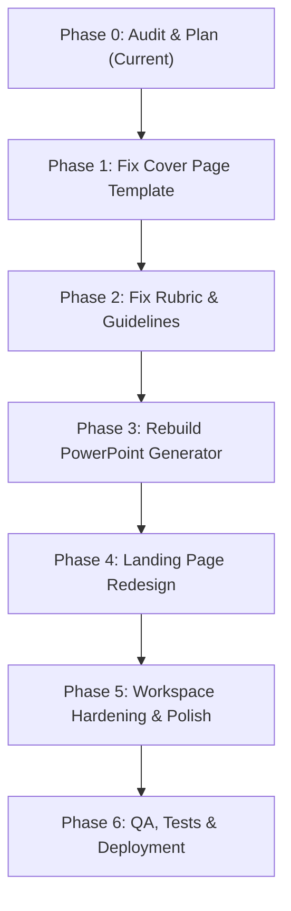

# AssignmentReady — Architecture Audit & Comprehensive Fix Plan

**Date:** October 20, 2026  
**Auditor:** Senior Full-Stack Engineer  
**Status:** Phase 0 Complete — Audit & Plan (Zero Code Changes)  

---

## 1. Executive Summary & Architecture Overview

AssignmentReady is an academic document preparation platform comprising:
- **Backend (`apps/api`):** FastAPI application on Python 3.14, utilizing `python-docx` for OpenXML document manipulation, `python-pptx` for slide deck generation, `pypdf` / PyMuPDF for document extraction, and optional headless LibreOffice for high-fidelity PDF and image rendering.
- **Frontend (`apps/web`):** React 18 single-page application built with Vite, TypeScript, and Tailwind CSS. The user journey centers on a 6-step formatting wizard (`Workspace.tsx`), accompanied by specialized workspaces for Presentations (`PresentationWorkspace.tsx`), Assignment Doctor diagnostics (`AssignmentDoctorWorkspace.tsx`), and Profile Management (`ProfileManagerModal.tsx`).
- **Storage & Lifecycle:** Isolated directory per job in `apps/api/storage/{job_id}` managed by `job_manager.py` with multi-version tracking (`DocumentVersionRecord`), version lineage, and automatic time-to-live (TTL) expiration.

While foundational OpenXML and presentation mechanisms exist, critical end-to-end gaps currently cause uploaded user assets (cover templates, rubrics, module guidelines) to be dropped, ignored, or overwritten by built-in defaults during execution.

---

## 2. End-to-End Trace of User Asset Workflows

### A. Cover Page Template Workflow
1. **UI Upload & API Endpoint:**
   - Uploaded in `apps/web/src/features/workspace/steps/UploadStep.tsx` (lines 99–106) via `api.uploadCoverTemplate(jobId, file)`.
   - Dispatched to `POST /api/upload/template/{jobId}` (aliased to `POST /api/jobs/{job_id}/upload-cover`).
2. **Storage Location:**
   - Saved to disk at `apps/api/storage/{job_id}/cover_template.docx`.
   - Sets `record.has_cover_template = True` in `job_manager.py`.
3. **Target Consuming Function:**
   - `job_manager.py` lines 304–312 passes `cover_template_path` to `apply_formatting(...)` in `apps/api/src/modules/documents/formatter.py`.
   - `formatter.py` line 181 invokes `insert_cover_page_before(sec_break_cover, settings.cover_page, template_path=cover_template_path)`.
   - `cover_page.py` lines 47–50 determines whether to call `_insert_template_cover_before(...)` or `_insert_builtin_cover_before(...)`.
4. **Where Dropped, Ignored, or Overwritten:**
   - **Mode Reset in UI:** In `CollegeRulesStep.tsx`, choosing any preset college profile overwrites `settings` with `profile.settings`, which defaults `cover_page.mode = "builtin"`.
   - **UI Disconnect:** `CoverPageStep.tsx` has no file uploader or status indicator showing template detection; if the user doesn't toggle "Uploaded Template", `mode` remains `"builtin"`.
   - **Silent Fallback in Backend:** In `cover_page.py` line 47:
     ```python
     if cover_data.mode == "template" and template_path and template_path.exists():
         _insert_template_cover_before(target_p, cover_data, template_path)
     else:
         _insert_builtin_cover_before(target_p, cover_data)
     ```
     If `mode != "template"`, the uploaded template file is completely ignored.
   - **Run-Splitting Failure:** Word frequently breaks placeholders like `{{student_name}}` across multiple `<w:r>` runs (e.g. `['{{', 'student_', 'name}}']`). In `_insert_template_cover_before`, `replace_in_paragraph` matches single runs; when split across runs, it replaces `paragraph.text = updated_text`, wiping out all fonts, colors, sizes, and formatting.
   - **Early Return Bug:** `replace_in_paragraph` executes `return` immediately upon matching the first run, skipping subsequent placeholders in that paragraph.
   - **Case/Syntax Rigidity:** Only exact lowercase `{{placeholder}}` is recognized. `[Student Name]`, `<<Student Name>>`, `Student Name: ______`, or `{{Student_Name}}` are ignored.
   - **Section Properties Stripped:** Elements are copied via `tpl_doc.element.body.iterchildren()`, explicitly skipping `w:sectPr`. This strips headers, footers, page orientation, margins, and borders from the cover template.

---

### B. Marking Rubric Workflow
1. **UI Upload & API Endpoint:**
   - Uploaded in `UploadStep.tsx` (lines 108–115) via `api.uploadMarkingScheme(jobId, file)`.
   - Dispatched to `POST /api/upload/marking-scheme/{jobId}` (aliased to `POST /api/jobs/{job_id}/upload-rubric`).
2. **Storage Location:**
   - Saved to disk at `apps/api/storage/{job_id}/rubric.docx` (or `.pdf` / `.txt`).
   - Parsed by `rubric_analyzer.py` into `record.rubric_data` on the in-memory job record.
3. **Target Consuming Function:**
   - Supposed to be consumed by `apply_formatting` in `formatter.py` and inserted into the document via `apply_marking_scheme` in `marking_scheme.py`.
4. **Where Dropped, Ignored, or Overwritten:**
   - **Never Passed from Job Manager:** In `job_manager.py` line 309:
     ```python
     apply_formatting(
         input_file=input_file,
         output_file=v_out_path,
         settings=settings,
         cover_template_path=tpl_path,
     )
     ```
     Neither `job_dir / "rubric.docx"` nor `record.rubric_data` is passed to `apply_formatting`!
   - **Never Consumed in Formatter:** In `formatter.py` line 187:
     ```python
     if settings.marking_scheme.enabled:
         rubric_anchor = target_fm_p if settings.marking_scheme.placement == "after_cover" else None
         apply_marking_scheme(doc, settings.marking_scheme, anchor_paragraph=rubric_anchor)
     ```
     `apply_marking_scheme` accepts `uploaded_file_path=None`, but `formatter.py` never passes it.
   - **Hardcoded Placeholder Table in `marking_scheme.py`:** Line 38 falls back to 4 generic hardcoded criteria ("Understanding & Core Concepts", "Analysis & Critical Evaluation", etc.) if `scheme_data.criteria` is empty. The real uploaded file is never opened or deep-copied.
   - **Table Placement Bug:** `marking_scheme.py` calls `table = doc.add_table(...)`, which appends the table to the end of the Word document body rather than placing it before `anchor_paragraph` via XML insertion.
   - **UI Mode Missing:** The UI provides no toggle for "Insert original rubric" (deep copy) vs "Generate marking table" (clean table rebuild).

---

### C. Module Guidelines Workflow
1. **UI Upload & API Endpoint:**
   - Uploaded in `UploadStep.tsx` (lines 118–125) via `api.uploadGuidelines(jobId, file)`.
   - Dispatched to `POST /api/upload/guidelines/{jobId}` (aliased to `POST /api/jobs/{job_id}/upload-guidelines`).
2. **Storage Location:**
   - Saved to disk at `apps/api/storage/{job_id}/guidelines.pdf` (or `.docx` / `.txt`).
   - Parsed via `guideline_analyzer.py` (`analyze_guidelines`).
3. **Target Consuming Function:**
   - Supposed to update `FormattingSettings` in the UI, feed into `apply_formatting` in `formatter.py`, and drive `audit_compliance` in `compliance.py`.
4. **Where Dropped, Ignored, or Overwritten:**
   - **Overwritten in Wizard:** In `Workspace.tsx`, suggestions merged at Step 1 are obliterated when the user navigates to Step 2 (`CollegeRulesStep.tsx`), which overwrites `settings` with standard profile defaults.
   - **No Review Panel:** There is no "Detected Requirements" review panel where students can inspect, accept, or reject extracted rules.
   - **Auditor Disconnected:** `compliance.py` audits strictly against preset `FormattingSettings` and hardcoded heuristics; it never verifies against the uploaded guidelines document.
   - **Formatter Disconnected:** `job_manager.py` never passes `guidelines.pdf` or extracted constraints to `formatter.py`.

---

### D. PowerPoint Generation Workflow
1. **UI Trigger & API Endpoint:**
   - Initiated from `DownloadStep.tsx` ("Create PowerPoint" button) navigating to `PresentationWorkspace.tsx`.
   - API endpoints:
     - `POST /api/presentation/plan-slides`
     - `POST /api/presentation/generate-project-presentation/{project_id}`
     - `POST /api/presentation/generate`
2. **Storage Location:**
   - Saved to disk at `apps/api/storage/{job_id}/presentation_{presentation_id}.pptx`.
3. **Target Consuming Function:**
   - `build_presentation_outline_from_report` and `generate_powerpoint_presentation` in `apps/api/src/modules/presentation/ppt_generator.py`.
4. **Where Disconnected, Dull, or Lacking Integration:**
   - **Disconnected from Main Wizard:** In the primary 6-step formatting wizard, PowerPoint is not a integrated step; it is an optional external navigation link in Step 6.
   - **Content Extraction Limitations:** Bullet points are generated from basic extractive sentences without guaranteed mapping to the assignment's document headings, figures, and data tables.
   - **Visual Monotony:** Presentations default to repetitive bullet lists rather than contextually selecting comparison tables, timelines, metric cards, process diagrams, or charts based on content semantics.
   - **Slide Count & Conclusion Violations:** Inconsistent counting rules (whether Title/Agenda/Q&A count toward target) and tendency to replace conclusions with generic "Thank You" slides.

---

## 3. Root Cause Analysis Summary

| Bug | Root Cause |
| :--- | :--- |
| **1. Uploaded Cover Template Ignored** | (1) `settings.cover_page.mode` is reset to `"builtin"` by profile selection in Step 2; (2) `cover_page.py` silently falls back to built-in cover if `mode != "template"`; (3) Run-splitting in Word causes literal `{{placeholder}}` matching to fail; (4) Setting `paragraph.text = updated_text` wipes all styling; (5) Merging skips `sectPr`, discarding template headers, footers, and margins. |
| **2. Uploaded Marking Rubric Ignored** | (1) `job_manager.py` never passes the rubric file or parsed criteria to `apply_formatting`; (2) `formatter.py` never passes `uploaded_file_path` to `apply_marking_scheme`; (3) `marking_scheme.py` falls back to 4 hardcoded placeholder criteria; (4) `doc.add_table()` appends to document end instead of anchor position; (5) No OpenXML deep-copy mechanism exists for original tables. |
| **3. Module Guidelines Not Applied** | (1) Extracted suggestions merged in Step 1 are wiped by profile selection in Step 2; (2) No UI review panel exists for accepting/rejecting rules; (3) `compliance.py` and `formatter.py` never receive or audit against uploaded guideline files. |
| **4. PowerPoint Dull & Disconnected** | (1) Generation is isolated from the main formatting wizard; (2) Lack of dynamic layout selector (tables, process flows, metric cards, charts); (3) Real tables and figures from `original.docx` are not converted into PowerPoint objects; (4) Loose slide-count controls and weak conclusion synthesis. |

---

## 4. Dead Features, Unwired Controls & UI Gaps

1. **Review & Compliance Step (`ReviewComplianceStep.tsx`):**
   - Blue "Recommendation" callout boxes display advice, but have **zero interactive "Apply Fix" or "Quick Fix" buttons**.
   - No side-by-side preview of original vs. formatted document.
   - Progress bar is a static spinning icon (`Loader2`) without named pipeline stages.
2. **Cover Page Step (`CoverPageStep.tsx`):**
   - **No file upload or replace control**; file can only be uploaded in Step 1.
   - No preview of detected placeholders or badge confirming "Using your template".
3. **Marking Scheme Step (`MarkingSchemeStep.tsx`):**
   - **No mode selection** between "Insert original rubric" and "Generate marking table".
   - **No file upload control** on this step.
   - Placement options omit "Before Cover" and "As Appendix".
4. **Download Step (`DownloadStep.tsx`):**
   - "Download PDF" returns 404/422 if LibreOffice is missing, without inline graceful fallback.
   - **No "Download ZIP of everything" button**.
   - **No visible countdown timer** to 1-hour auto-cleanup.
5. **Requirements Step (`RequirementsStep.tsx`):**
   - Lacks a "Detected Requirements" review panel for module guidelines.
6. **State Persistence & Resilience:**
   - **No `sessionStorage` persistence**: refreshing the page wipes all wizard state, uploaded files, and metadata.
   - **No Global Error Boundary**: any uncaught React error produces a blank screen.
   - College profile JSON import in `profiles.ts` lacks schema validation.
7. **Backend Security & Operations:**
   - `security.py` lacks zip-bomb protection (uncompressed byte and file count limits).
   - No rate limiting middleware on API endpoints.

---

## 5. Prioritized Implementation Plan



### Phase 1: Fix the Cover Page Template
- **Backend:**
  - `apps/api/src/modules/documents/cover_page.py`:
    - Implement robust run-merging placeholder replacement that traverses runs without erasing paragraph formatting.
    - Support case-insensitive variations: `{{...}}`, `[...]`, `<<...>>`, and `"Field: _____"` patterns for `student_name`, `student_id`, `assignment_title`, `module_name`, `module_code`, `lecturer`, `due_date`, `submission_date`, `word_count`, `university`, `department`.
    - Preserve template `sectPr`, logos, tables, textboxes, and unlinked headers/footers with page number suppression.
    - Implement placeholder extraction report (`detected`, `replaced`, `unfilled`).
  - `apps/api/src/modules/jobs/job_manager.py`:
    - Auto-set `settings.cover_page.mode = "template"` whenever a template file exists.
  - `apps/api/src/main.py`:
    - Return `cover_template_report` from `/api/jobs/{job_id}/upload-cover`.
- **Frontend:**
  - `apps/web/src/features/workspace/steps/CoverPageStep.tsx`:
    - Add template upload/replace button, "Using your template" badge, live cover preview, and unfilled placeholder mapping interface.
  - `apps/web/src/features/workspace/steps/CollegeRulesStep.tsx`:
    - Prevent profile selection from resetting `cover_page.mode` to `"builtin"`.
- **Tests:**
  - `apps/api/tests/test_cover_page_template.py`:
    - Tests for split runs, table placeholders, headers, zero-placeholder warnings, and integration test with `sample-files/official_cover_template.docx`.

### Phase 2: Fix Marking Rubric and Module Guidelines
- **Backend:**
  - `apps/api/src/modules/documents/marking_scheme.py`:
    - Implement OpenXML deep-copy table insertion from uploaded `.docx` or parsed `.pdf` rubric.
    - Support XML-level insertion before anchor paragraphs for all placements (`after_cover`, `before_references`, `end_of_document`, `appendix`).
  - `apps/api/src/modules/documents/formatter.py`:
    - Wire `uploaded_file_path` and `rubric_data` into `apply_marking_scheme`.
  - `apps/api/src/modules/documents/guideline_analyzer.py`:
    - Expand deterministic rule extraction (citation style, word limit, fonts, spacing, margins, headings) with confidence ratings.
  - `apps/api/src/modules/documents/compliance.py`:
    - Feed confirmed guideline rules into compliance auditing.
- **Frontend:**
  - `apps/web/src/features/workspace/steps/MarkingSchemeStep.tsx`:
    - Add mode selector ("Insert original rubric" vs "Generate clean table"), placement choices, and editable criteria table preview.
  - `apps/web/src/features/workspace/steps/RequirementsStep.tsx`:
    - Add "Detected Requirements" review panel with accept/edit/reject controls.
- **Tests:**
  - `apps/api/tests/test_rubric_and_guidelines.py`:
    - Tests for rubric table extraction, OpenXML deep copy, and guideline-driven compliance auditing.

### Phase 3: Rebuild the PowerPoint Generator
- **Backend (`apps/api/src/modules/presentation/`):**
  - `report_analyzer.py`: Extract document headings, tables, figures, and key extractive sentences.
  - `ppt_generator.py`:
    - Use slide master layouts (Title, Section, Two-Column, Table, Image, Metric Cards, Process Flow).
    - Map real tables and figures from `.docx` to slide objects.
    - Native charts (bar, line, doughnut) for numeric data.
    - 5 academic themes (Academic Navy, Minimal White, Dark Modern, Warm Neutral, University Brand).
    - Substantive conclusion synthesis (verdict, takeaways, recommendations).
- **Frontend (`apps/web/src/features/presentation/` & `Workspace.tsx`):**
  - Integrate PowerPoint configuration directly into wizard or seamless workflow.
  - Add thumbnail previews, slide reordering, section toggles, and slide count controls.
- **Tests:**
  - `apps/api/tests/test_smart_presentation_planner.py`:
    - Generate from `sample-files/sample_ai_draft.docx` and verify structure, slide counts, and table rendering.

### Phase 4: Redesign Landing Page
- **Frontend (`apps/web/src/features/landing/`):**
  - Hero with before/after comparison preview.
  - Trust strip ("No account · No AI · Files auto-deleted in 1 hour · Free").
  - 4-step "How It Works" section and feature grid.
  - Interactive demo file dropzone.
  - Full SEO tags, Open Graph, meta descriptions in `index.html`.
  - WCAG AA accessibility, light/dark responsiveness, and subtle micro-interactions.

### Phase 5: Workspace Hardening & Polish
- **Frontend (`apps/web/src/features/workspace/`):**
  - Implement real step-by-step progress tracking for formatting pipeline.
  - Add `sessionStorage` state persistence across page refreshes.
  - Add Global `ErrorBoundary` with recovery actions.
  - Side-by-side preview and clickable quick-fix actions in `ReviewComplianceStep.tsx`.
  - Add "Download ZIP of everything" and visible 1-hour auto-deletion countdown in `DownloadStep.tsx`.
  - JSON schema validation on profile imports in `profiles.ts`.
- **Backend:**
  - Zip-bomb protection and uncompressed size validation in `security.py`.
  - Rate limiting middleware and structured logging in `main.py`.

### Phase 6: QA, Tests & Deployment
- Comprehensive test runs: `pytest` and `npm run build`.
- Playwright E2E test verifying end-to-end workflow with sample files.
- GitHub Actions CI workflow (`.github/workflows/ci.yml`).
- Dockerfile / `render.yaml` with headless LibreOffice support.
- Documentation: updated `README.md` and `docs/CHANGELOG.md`.

---

## 6. Verification and Approval

Phase 0 audit is complete. No application code was altered during this phase. Code modifications will commence with **Phase 1: Fix the Cover Page Template** upon user instruction.
